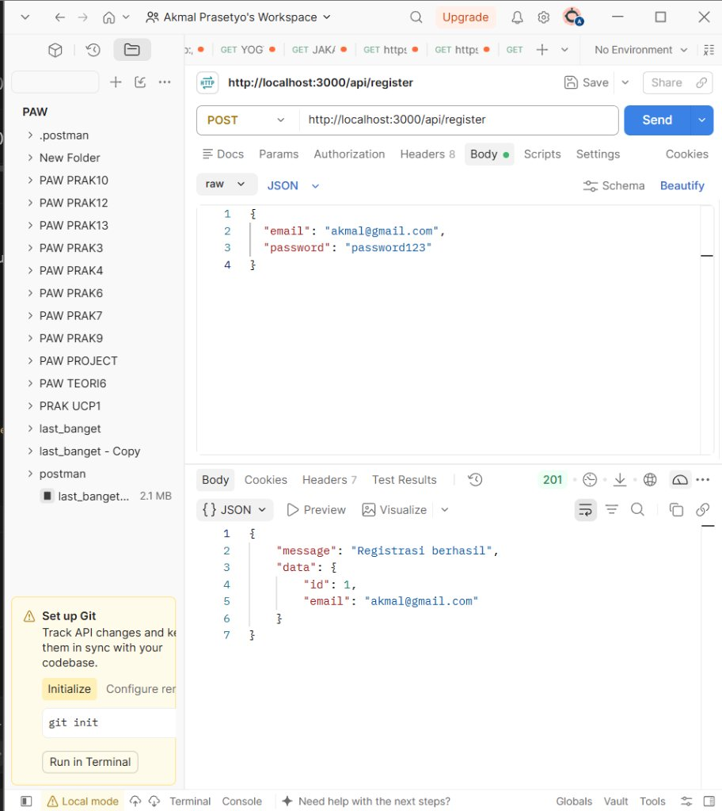
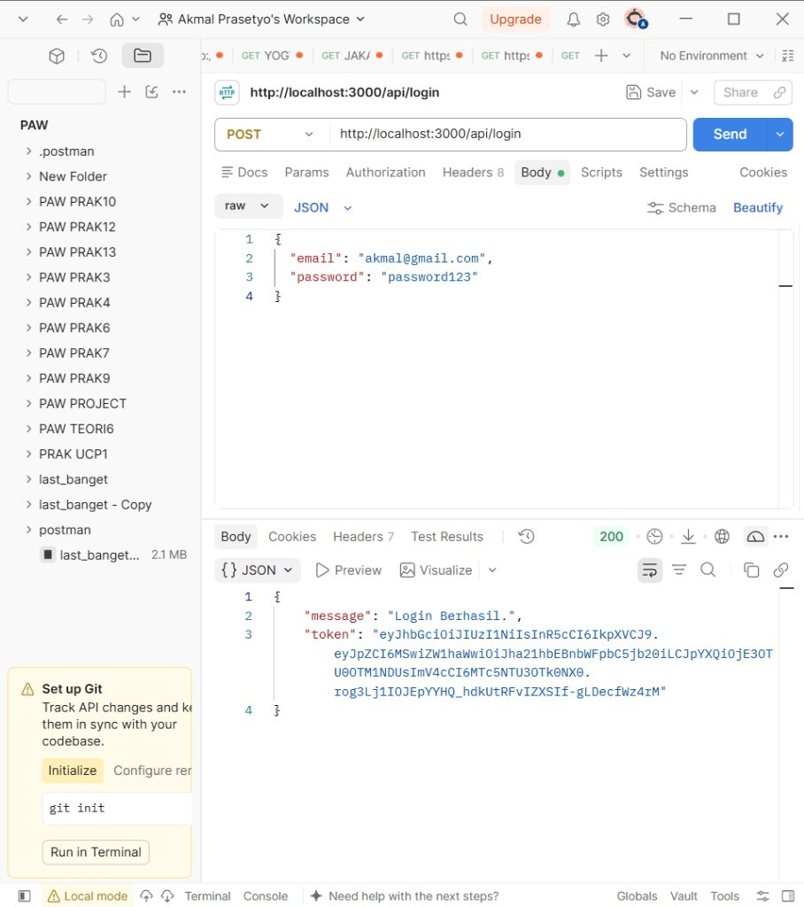
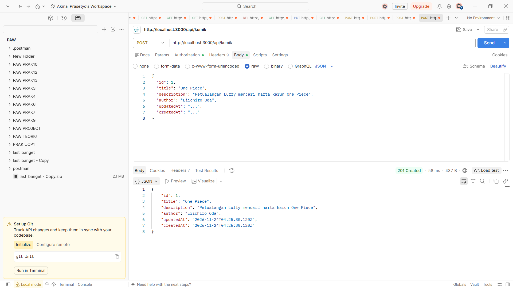
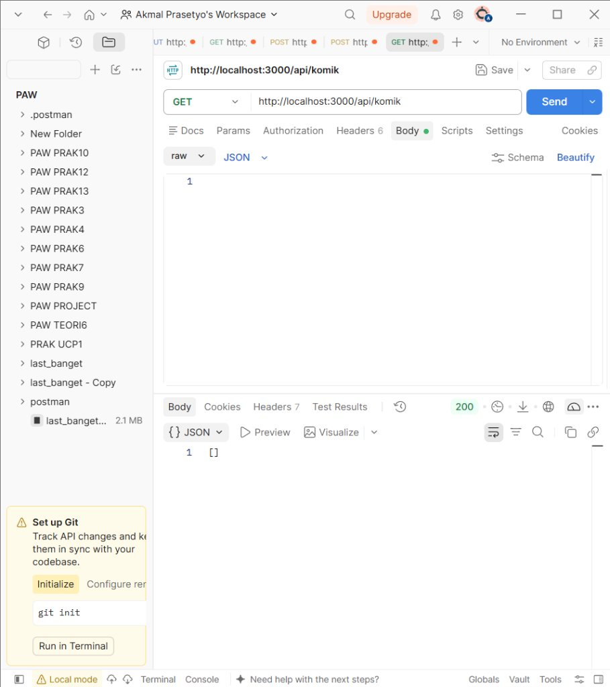
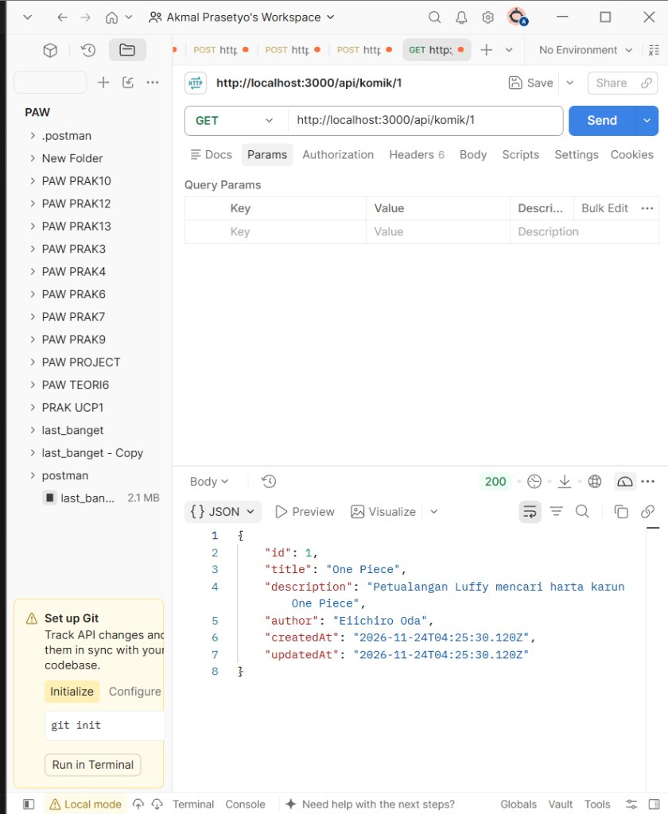
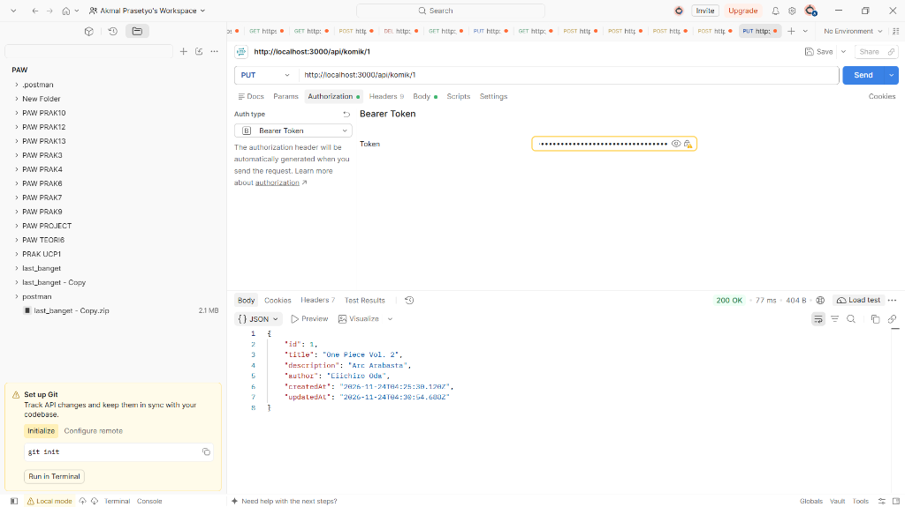
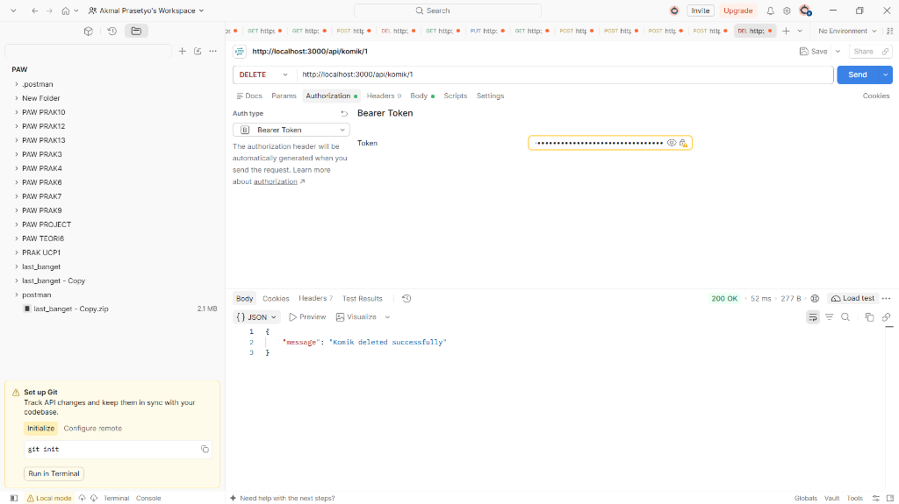

# Praktikum 11 PWS — REST API Komik dengan Autentikasi JWT

Proyek REST API menggunakan **Express.js**, **Sequelize**, **PostgreSQL**, **bcrypt**, dan **JSON Web Token (JWT)** untuk autentikasi pengguna serta operasi CRUD data Komik.

## Teknologi yang Digunakan
- Node.js & Express.js
- PostgreSQL & Sequelize ORM
- JSON Web Token (`jsonwebtoken`) & `bcrypt`
- `dotenv` & `nodemon`

## Cara Menjalankan
1. Install dependensi:
   ```bash
   npm install
   ```
2. Salin `.env.example` menjadi `.env` lalu sesuaikan konfigurasi database PostgreSQL dan `JWT_SECRET`.
3. Jalankan server:
   ```bash
   npm start
   ```
   Server berjalan di `http://localhost:3000`.

## Daftar Endpoint API

| Fitur | Method | Endpoint | Autentikasi |
| :--- | :--- | :--- | :--- |
| Register User | `POST` | `/api/register` | Tidak |
| Login User | `POST` | `/api/login` | Tidak |
| Tambah Komik | `POST` | `/api/komik` | Bearer Token (JWT) |
| Lihat Semua Komik | `GET` | `/api/komik` | Tidak |
| Lihat Komik by ID | `GET` | `/api/komik/:id` | Tidak |
| Update Komik | `PUT` | `/api/komik/:id` | Bearer Token (JWT) |
| Hapus Komik | `DELETE` | `/api/komik/:id` | Bearer Token (JWT) |

## Hasil Pengujian Postman

### 1. Register (`POST /api/register`)


### 2. Login & Mendapatkan Token JWT (`POST /api/login`)


### 3. Tambah Komik dengan Bearer Token (`POST /api/komik`)


### 4. Ambil Semua Komik (`GET /api/komik`)


### 5. Ambil Komik Berdasarkan ID (`GET /api/komik/1`)


### 6. Update Komik dengan Bearer Token (`PUT /api/komik/1`)


### 7. Hapus Komik dengan Bearer Token (`DELETE /api/komik/1`)

